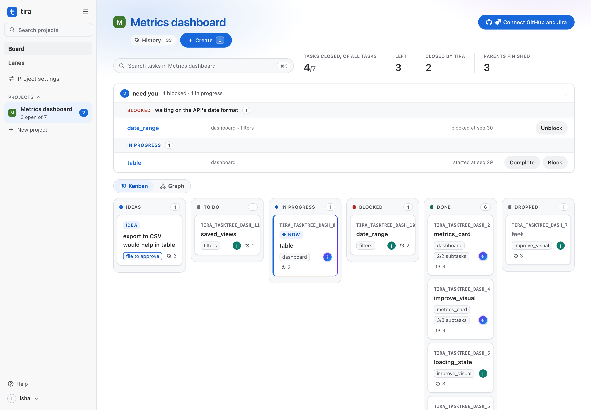
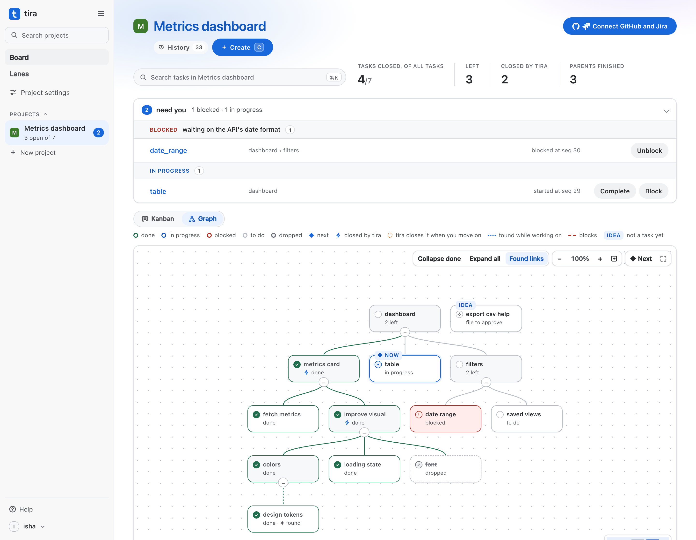

# tira

## [Try it live →](https://tira-xags.onrender.com)

**AI agents pick up tickets, do the work and say "done." tira asks for the proof.** Nothing is marked done without it, and an agent's proof has to be a real commit or pull request, checked on GitHub. Every move is written once to a log nobody can rewrite, and the board is recomputed from that log on every visit, so it shows what happened, not what someone remembers.

**Live:** [board](https://tira-xags.onrender.com) · Claude connector at `https://tira-xags.onrender.com/mcp`. Sign up with GitHub; there's nothing to install. It runs on Render's free plan, so after a quiet spell the first visit takes about a minute to wake.

**Agents work the board through MCP.** Claude Code, Cursor, VS Code, Claude Desktop and claude.ai connect, each agent with its own token. Ten tools: next task, list, get, start, complete with proof, block with a reason, add a subtask, file an idea, comment, and fill in a ticket. There is no tool to cancel, reopen, unblock or delete: those stay with people. An agent's moves go through the same rules as a person's and show on the board under the agent's name. Give an agent a Claude Code routine, and @mentioning it on a task (or giving it one) starts it in Anthropic's cloud, with no need to go and tell it.

**Review when it matters.** Each task has a work type (code, spec, design, research and more), which tira guesses and you can change: code is proven by a pull request or commit, anything else by a link or a file, like a screenshot. Turn on Review for a task and Meta's Muse model checks the work against its ticket before it's done, as an adversarial checker that's never the one who did it. Each problem it finds becomes a fix subtask under the task, so it can't close until they're done, and then it's reviewed again. A person always has the final say.

**GitHub and Jira stay in step.** Link a project to a repo and a Jira project, then press Sync. tira links the pull requests that name a task and offers a merged one as its proof, makes a Jira issue for every task, and brings people's Jira moves back as commands. Its rules can refuse those too: Done in Jira with no proof is refused, and the refusal is in the history.

**Result:** all **1115** planted bugs caught · **542** tests pass on Postgres, 0 fail · the two times the factory lied, replayed, are both refused

<picture>
  <source media="(prefers-color-scheme: dark)" srcset="docs/assets/kanban-dark.png">
  
</picture>

## The problem

Devansh runs a software factory where AI workers do the building. Tracking that work was a second job: who picked up what, what's moving and what went quiet, pieced together from chats, files and lists at every status check.

Twice the factory lied to him. A session that had gone quiet was assumed stood down while it was still running. Work was marked landed after skipping every check. And good ideas came up in chat and died there, because turning them into tracked work was a chore nobody owned.

## What it does

1. **Record:** every change is one event appended to a Postgres log. Its triggers refuse edits, deletes and truncates.
2. **Recompute:** the board, the task tree and what's next are folded from the log on every request. There is no "current task" field to drift.
3. **Refuse:** transition tables in [`charts/`](charts/) check every write. Done without proof is refused, and the refusal is logged too.
4. **Close for you:** when you move on to other work, tira closes the finished parent itself, as `tira`, citing your move.
5. **Catch ideas:** an agent files an idea in one sentence. tira drafts it and proposes where it goes, and it becomes a task after two approvals by a person.
6. **Rewind:** replay to any event to see what the system believed at that moment.

<picture>
  <source media="(prefers-color-scheme: dark)" srcset="docs/assets/graph-dark.png">
  
</picture>

## Result

| Check | Run it | Result |
|---|---|---|
| Planted bugs: each breaks one rule on purpose | `npm run mutants` | **1115 / 1115** caught (last full run 2026-10-26) |
| The test suite, Postgres included | `TIRA_PG_URL=… npm test` | **542** pass, 0 fail, 6 to do |
| The same, with no database | `npm test` | 475 pass, 46 skipped (they need Postgres) |
| The rule tables against the XState charts they come from | `npm run verify` | 282 checks pass |
| Incident 1: a quiet session | in the suite (`scenarios/I1-silent-session.json`) | not stood down by a timeout |
| Incident 2: landed without checks | in the suite (`scenarios/I2-unchecked-landing.json`) | not verified without a PASS, and never by whoever filed it |

**Planted bugs are reported because a passing suite alone would flatter us.** A suite can pass while missing what matters; here each planted bug has to make at least one test fail, or the run fails. `npm run mutants:check` proves in under a second that every one still lands exactly once.

## Run locally

Needs Node 22.18+ and Docker (for Postgres).

```bash
git clone https://github.com/devpath56/tira && cd tira
npm install
npm test                                  # no network, no keys; the Postgres tests skip

docker run -d --name tira-pg -e POSTGRES_USER=tira -e POSTGRES_PASSWORD=<pick one> \
  -e POSTGRES_DB=tira -p 127.0.0.1:5433:5432 postgres:17
export TIRA_DATABASE_URL='postgresql://tira:<pick one>@127.0.0.1:5433/tira'
export TIRA_SECRET_KEY='<a long random string>'   # seals people's tokens in the database
TIRA_PG_URL=$TIRA_DATABASE_URL npm test   # everything, Postgres included
node scripts/tira.ts serve --actor you    # the board on http://127.0.0.1:4747
```

Sign-in with GitHub, connecting agents and hosting your own copy on Render ([`render.yaml`](render.yaml)) are in [the long version](docs/ENGINEERING.md).

## Repo map

```
src/        the core: event store, rule runner, fold and guarded writes; the page, sign-in,
            MCP server, GitHub and Jira sync, health sweeps, the divergence watchdog
charts/     the rules as transition tables (JSON), generated from XState charts and checked against them
scenarios/  the plan's tests as event scripts, both incidents included
test/       node:test suites; scripts/mutants.ts plants the bugs
tira-docs/  one doc per page component, checked against the build
docs/       the long version (ENGINEERING.md), the decision log, the roadmap, Postgres setup
demo/       the story in 9 scenarios: open demo/demo-deck-v6.html in a browser
```

Built by Isha Mishra and Devansh Pathak, with Claude Code. The plan is [`build-plan.md`](build-plan.md); what we built, bought or cloned for each layer is in [`packing.md`](packing.md). Every rule, demo script and decision is in [`docs/ENGINEERING.md`](docs/ENGINEERING.md).
